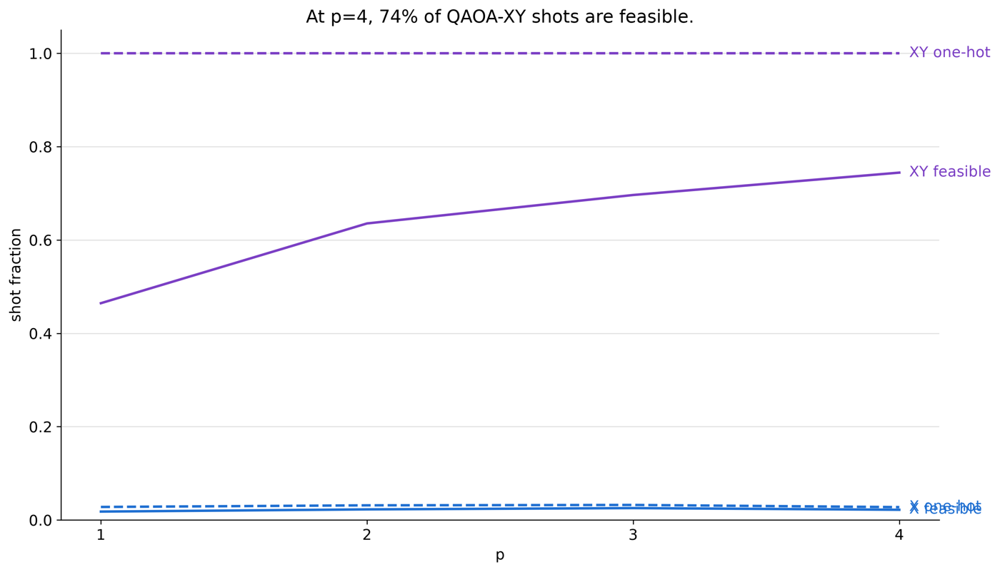
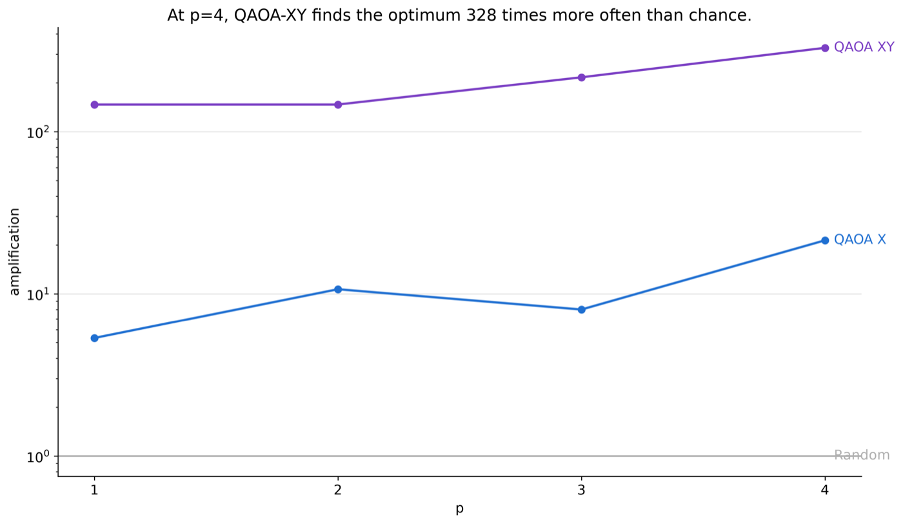
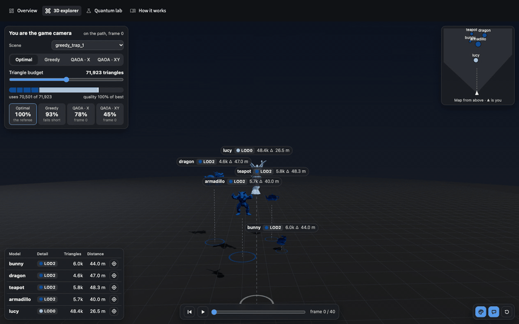
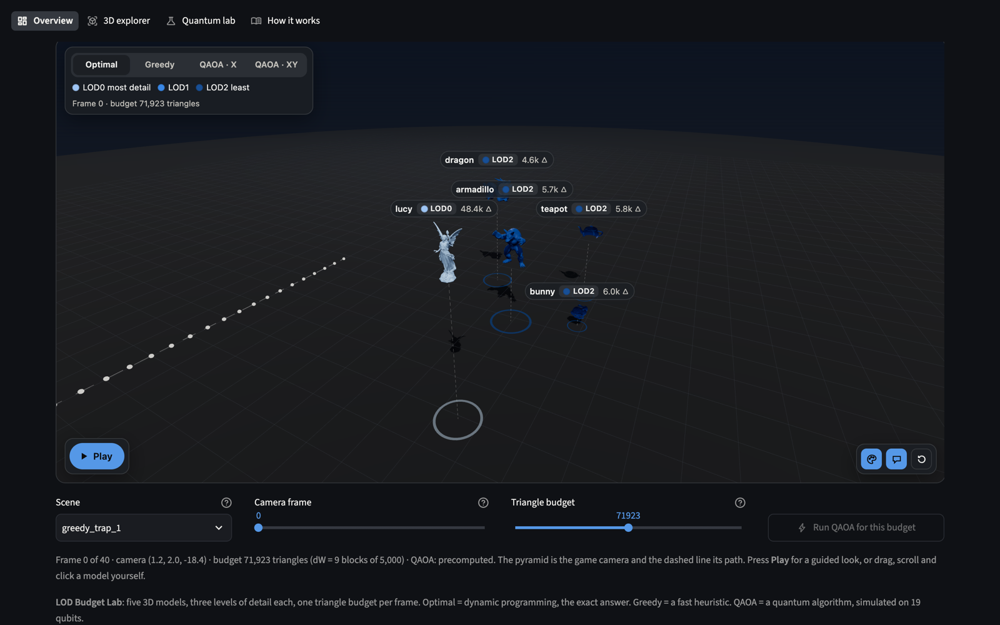
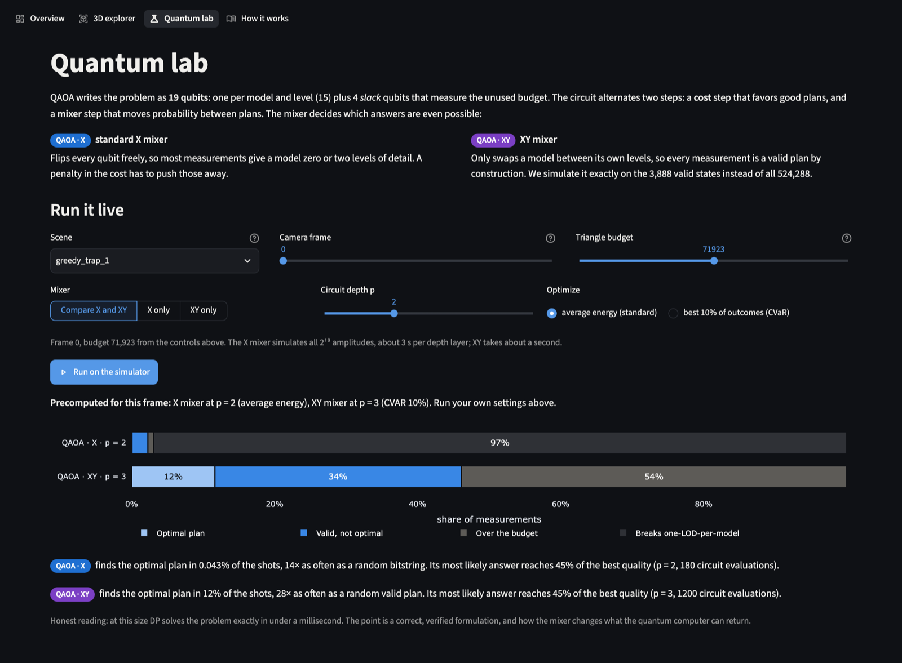
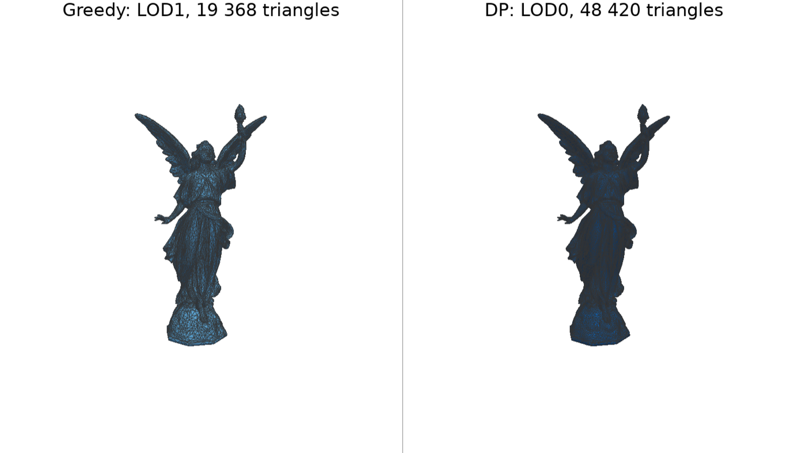

# lod-qaoa

> **Winner of the first track, "Quantum Optimization", at IBM Qiskit Fall Fest 2026.**

Choosing a level of detail (LOD) for each object in a 3D scene under a hard per-frame
triangle budget, written as a QUBO and solved with QAOA (Qiskit), then compared honestly
with exact dynamic programming, a greedy baseline and random sampling.

## Results

<!-- RESULTS:START -->

Scene `greedy_trap_1`, mean ± std over runs.

| Method | AR top-1 | P_feas | Budget use | P_opt gain |
|---|---:|---:|---:|---:|
| DP | 1.000 ± 0.000 | 1.000 ± 0.000 | 1.000 ± 0.000 | 32768.000 ± 0.000 |
| Greedy | 0.863 ± 0.000 | 1.000 ± 0.000 | 0.667 ± 0.000 | 0.000 ± 0.000 |
| Random | 0.635 ± 0.000 | 0.001 ± 0.000 | 1.000 ± 0.000 | 1.000 ± 0.000 |
| QAOA-X p=1 | 0.446 ± 0.069 | 0.018 ± 0.001 | 0.778 ± 0.192 | 5.333 ± 9.238 |
| QAOA-X p=2 | 0.664 ± 0.102 | 0.023 ± 0.001 | 1.000 ± 0.000 | 10.667 ± 4.619 |
| QAOA-X p=3 | 0.605 ± 0.234 | 0.025 ± 0.002 | 0.889 ± 0.192 | 8.000 ± 8.000 |
| QAOA-X p=4 | 0.716 ± 0.219 | 0.022 ± 0.002 | 1.000 ± 0.000 | 21.333 ± 12.220 |
| QAOA-XY p=1 | 0.499 ± 0.083 | 0.465 ± 0.011 | 1.000 ± 0.000 | 146.667 ± 25.716 |
| QAOA-XY p=2 | 0.565 ± 0.150 | 0.635 ± 0.006 | 1.000 ± 0.000 | 146.667 ± 32.332 |
| QAOA-XY p=3 | 0.584 ± 0.243 | 0.696 ± 0.004 | 1.000 ± 0.000 | 216.000 ± 21.166 |
| QAOA-XY p=4 | 0.571 ± 0.136 | 0.744 ± 0.009 | 1.000 ± 0.000 | 328.000 ± 40.000 |

<!-- RESULTS:END -->

AR top-1 is the value of the most frequent feasible sample divided by the DP optimum.
P_feas is the fraction of shots that are one-hot and within budget. Budget use is the
budget used by the best feasible sample divided by the available budget. P_opt gain is
the probability of sampling the DP optimum divided by its probability under uniform
sampling. DP and Greedy are deterministic, so their P_opt gain is 1 / P_opt(uniform)
when they return the DP choice and 0 when they do not.

The runs come from `configs/readme.yaml`: the three greedy trap scenes, X and XY mixers,
p = 1..4, 3 seeds, 2 optimizer starts of at most 150 COBYLA iterations each and 4096
shots, on the exact statevector simulator. To reproduce them, run
`uv run python -m lodq.experiments --config configs/readme.yaml`, then
`uv run python scripts/results_table.py --scene greedy_trap_1`.

<details>
<summary>The same table for <code>greedy_trap_2</code> and <code>greedy_trap_3</code></summary>

Scene `greedy_trap_2`, mean ± std over runs.

| Method | AR top-1 | P_feas | Budget use | P_opt gain |
|---|---:|---:|---:|---:|
| DP | 1.000 ± 0.000 | 1.000 ± 0.000 | 1.000 ± 0.000 | 32768.000 ± 0.000 |
| Greedy | 0.866 ± 0.000 | 1.000 ± 0.000 | 0.800 ± 0.000 | 0.000 ± 0.000 |
| Random | 0.576 ± 0.000 | 0.001 ± 0.000 | 1.000 ± 0.000 | 1.000 ± 0.000 |
| QAOA-X p=1 | 0.698 ± 0.161 | 0.015 ± 0.002 | 1.000 ± 0.000 | 10.667 ± 4.619 |
| QAOA-X p=2 | 0.366 ± 0.063 | 0.018 ± 0.004 | 0.967 ± 0.058 | 2.667 ± 4.619 |
| QAOA-X p=3 | 0.611 ± 0.255 | 0.021 ± 0.003 | 0.967 ± 0.058 | 5.333 ± 4.619 |
| QAOA-X p=4 | 0.663 ± 0.264 | 0.023 ± 0.000 | 0.800 ± 0.200 | 2.667 ± 4.619 |
| QAOA-XY p=1 | 0.727 ± 0.082 | 0.642 ± 0.010 | 1.000 ± 0.000 | 122.667 ± 36.074 |
| QAOA-XY p=2 | 0.654 ± 0.171 | 0.808 ± 0.006 | 1.000 ± 0.000 | 74.667 ± 4.619 |
| QAOA-XY p=3 | 0.579 ± 0.199 | 0.856 ± 0.006 | 1.000 ± 0.000 | 133.333 ± 32.332 |
| QAOA-XY p=4 | 0.555 ± 0.165 | 0.866 ± 0.003 | 1.000 ± 0.000 | 130.667 ± 4.619 |

Scene `greedy_trap_3`, mean ± std over runs.

| Method | AR top-1 | P_feas | Budget use | P_opt gain |
|---|---:|---:|---:|---:|
| DP | 1.000 ± 0.000 | 1.000 ± 0.000 | 1.000 ± 0.000 | 32768.000 ± 0.000 |
| Greedy | 0.869 ± 0.000 | 1.000 ± 0.000 | 0.833 ± 0.000 | 0.000 ± 0.000 |
| Random | 0.610 ± 0.000 | 0.002 ± 0.000 | 1.000 ± 0.000 | 1.000 ± 0.000 |
| QAOA-X p=1 | 0.632 ± 0.226 | 0.015 ± 0.002 | 0.917 ± 0.083 | 2.667 ± 4.619 |
| QAOA-X p=2 | 0.606 ± 0.098 | 0.021 ± 0.001 | 0.944 ± 0.048 | 0.000 ± 0.000 |
| QAOA-X p=3 | 0.784 ± 0.092 | 0.019 ± 0.001 | 0.917 ± 0.083 | 2.667 ± 4.619 |
| QAOA-X p=4 | 0.720 ± 0.091 | 0.021 ± 0.001 | 0.944 ± 0.048 | 2.667 ± 4.619 |
| QAOA-XY p=1 | 0.624 ± 0.037 | 0.731 ± 0.003 | 1.000 ± 0.000 | 189.333 ± 46.876 |
| QAOA-XY p=2 | 0.538 ± 0.115 | 0.857 ± 0.006 | 1.000 ± 0.000 | 117.333 ± 45.490 |
| QAOA-XY p=3 | 0.724 ± 0.132 | 0.907 ± 0.003 | 1.000 ± 0.000 | 101.333 ± 30.288 |
| QAOA-XY p=4 | 0.593 ± 0.115 | 0.856 ± 0.003 | 1.000 ± 0.000 | 213.333 ± 20.133 |

</details>

### Best quantum results

- **The exact optimum in about 1 shot of 9.** Our best setting is the XY mixer at
  p = 3, trained on CVaR (the best 10% of outcomes) instead of the mean energy. The demo
  uses it. Along all 41 camera frames of the `greedy_trap_1` path it puts 11.6–11.7% of
  the probability on the DP optimum. That is 28 times more often than a random
  one-LOD-per-model plan (1 in 243) and about 3,800 times more often than a random
  19-bit string. On the 21 frames where Greedy misses the optimum and reaches only
  86–93% of it, QAOA still returns the optimum about once every 9 shots.
- **CVaR training matters most.** With the mean energy as the objective, the XY mixer
  puts at most 0.9% on the optimum (`greedy_trap_1`, p = 4). That is 291 times a
  random bitstring, but only 2.2 times a random valid plan.
- **Valid plans instead of noise.** The XY mixer never breaks the one-LOD-per-model rule,
  and 47–91% of its shots also fit the budget (best: `greedy_trap_3`, p = 3, 90.5%).
  The X mixer reaches 1.6–2.6%, and random bitstrings 0.1–0.2%.
- **Every XY run sampled the optimum.** In all 36 XY runs (3 scenes × 3 seeds × p = 1..4)
  the DP optimum is among the 4096 shots, so the best sample beats Greedy, which stops at
  86–87% of the optimum on all three trap scenes. With the X mixer this happens in 19 of
  36 runs.
- **The most frequent answer is cautious.** On average the most frequent valid sample is
  worth 37–78% of the optimum (best: QAOA-X at p = 3 on `greedy_trap_3`, 0.78), below
  Greedy. One run did beat Greedy on this measure (QAOA-X, p = 1, `greedy_trap_3`,
  seed 2: 0.89 against 0.87), but that is shot noise: its exact distribution gives 0.31.

<p>
  
  
</p>

`greedy_trap_1`, mean over 3 seeds, energy objective. "Chance" on the right is a uniformly
random 19-bit string.

## Demo



**3D explorer**, at about 2× speed. The game camera flies along its path. On every
step the browser solves the budget problem again with DP and Greedy and swaps each model
to its level of detail. The cards on the left score Greedy and both QAOA mixers against
the optimum for the current frame.



**Overview**: one camera frame as a 3D view. Switch between Optimal, Greedy, QAOA · X and
QAOA · XY to see which level of detail each method picks, or press **Play** for a guided
tour.



**Quantum lab**: the X and XY mixers on the same frame. With the X mixer 97% of the
shots break the one-LOD-per-model rule. The XY mixer never breaks it and samples the
optimum in 12% of the shots.



**The greedy trap** (`make render`, `greedy_trap_1`). Greedy upgrades the dragon and
Lucy to LOD1. After that no other upgrade fits, so it stops with 77% of the budget used.
The optimum leaves the dragon coarse, gives Lucy LOD0 (48,420 triangles instead of
19,368) and uses 98% of the budget.

## Method

**Problem.** A scene has N = 5 objects, each with M = 3 LODs: j = 0 is the most detailed
and j = 2 the coarsest. Exactly one LOD is picked per object, and the total triangle
count must fit the frame budget while maximising visual utility. This is a
multiple-choice knapsack problem (MCKP).

**Utility.** For object i at LOD j,
v<sub>ij</sub> = S<sub>i</sub> · q<sub>j</sub> / d<sub>i</sub><sup>α</sup>, where
S<sub>i</sub> = 4πR<sub>i</sub><sup>2</sup> · importance<sub>i</sub>,
d<sub>i</sub> is the distance to the camera, α = 1.5 and q = (1.0, 0.65, 0.25).
v is normalised so that max v = 1.

**Delta weights and budget quantisation.** Every object costs at least its coarsest LOD,
so that cost is moved into a fixed base W<sub>base</sub> = Σ<sub>i</sub> w<sub>i,M−1</sub>.
The remaining weights and budget are counted in blocks of 5000 triangles:

- dw<sub>ij</sub> = ⌈(w<sub>ij</sub> − w<sub>i,M−1</sub>) / 5000⌉, so dw<sub>i,M−1</sub> = 0
- dW = ⌊(W<sub>max</sub> − W<sub>base</sub>) / 5000⌋, typically 8 to 15

Rounding the weights up and the budget down means that every choice the model accepts
also fits the real triangle budget.

**Baselines.** DP solves the MCKP exactly and is the reference. Greedy starts from the
coarsest LOD everywhere and keeps applying the upgrade with the best utility gain per
budget block. Random is the exact uniform distribution over all 2<sup>19</sup> bitstrings,
the same baseline that P_opt gain is measured against.

**Scenes.** `scenes/default.yaml` is the base scene. `greedy_trap_1..3` were found
with `scripts/find_greedy_trap.py`: there Greedy stops with budget it cannot use and
misses the optimum, so it is a fair test for QAOA. `random_000..019` are random scenes
for `configs/main_random.yaml`.

**QUBO.** Binary x<sub>ij</sub> = 1 means object i uses LOD j. The inequality is turned
into an equality with K = ⌊log<sub>2</sub> dW⌋ + 1 slack bits s<sub>k</sub> of weight 2<sup>k</sup>.
The energy to minimise is

$$
E(x, s) = -\sum_{i,j} v_{ij} x_{ij}
+ A \sum_i \Big(1 - \sum_j x_{ij}\Big)^2
+ B \Big(\sum_{i,j} dw_{ij} x_{ij} + \sum_k 2^k s_k - dW\Big)^2
$$

**Qubits.** With dW ≤ 15 this gives N·M = 15 decision qubits plus K = 4 slack qubits,
19 qubits in total.

**Penalties.** A = 1.5 · max v. Going over the budget by one block costs only B, so B
must be larger than the biggest gain from a single upgrade,
B > max<sub>ij</sub> (v<sub>ij</sub> − v<sub>i,M−1</sub>). We use 1.2 times that value.
The common rule of thumb B ≈ max(Δv/Δw) is not safe here.

**Verification.** For every scene, all 2<sup>19</sup> states are enumerated
(`lodq.qubo.verify_qubo`). The penalties are accepted only if the ground state is
unique, feasible and equal to the DP solution, with an energy margin to every
infeasible state. The QUBO → Ising mapping is checked the same way against a statevector.

**QAOA.** The standard X mixer, and an XY mixer that keeps the one-hot constraint
(started from W states, with A = 0). Angles are optimised with multistart COBYLA using
linear-ramp, random and warm starts from depth p − 1. Experiments use an exact numpy
statevector (`fastsim`), and the final counts are sampled with Qiskit Aer.

## Quickstart

Requires uv. Python 3.12 is installed by uv.

```bash
make all QUICK=1   # install, test, build assets, quick experiments, figures, renders
make precompute    # DP, Greedy, QAOA (X and XY mixers) for every camera frame, ~9 min
make demo          # interactive Streamlit demo
```

`make all` without `QUICK=1` runs the full grid from `configs/main.yaml`: the three
greedy trap scenes, p = 1..4, X and XY mixers, 5 seeds each.

The demo reads its camera frames from `cache/path`, so run `make precompute` once before
`make demo`. Add `--limit 10` to `scripts/precompute_path.py` for a quick try on the
first 10 frames.

Without uv, every target is the same command run with the virtualenv's Python:

```bash
python3.12 -m venv .venv
.venv/bin/pip install -e . pytest ruff
.venv/bin/python -m pytest -q
.venv/bin/python scripts/precompute_path.py --exact
.venv/bin/python -m streamlit run app/streamlit_app.py
```

### Make targets

| Target | What it does |
|---|---|
| `make install` | `uv sync` |
| `make test` | The full test suite; `uv run pytest -m "not slow"` skips the 2^19 enumerations of random scenes |
| `make lint` | `ruff check src tests` |
| `make assets` | Rebuilds the LOD meshes in `assets/lods/` (they are committed) |
| `make experiments` | Experiment grid from `configs/main.yaml` (or `configs/smoke.yaml` with `QUICK=1`) into `runs/` and `runs/summary.csv` |
| `make figures` | Figures in `figures/` from the saved runs |
| `make render` | `figures/compare_render.png` and `figures/compare_zoom.png` with PyVista |
| `make precompute` | Camera frames for the demo in `cache/path` |
| `make demo` | Streamlit demo |
| `make all` | `install`, `test`, `assets`, `experiments`, `figures` and `render` |

`scripts/check_release.py` checks that the figures are newer than `runs/summary.csv` and
that this README has its results block.

### Demo pages

The demo has four pages:

- **Overview**: one camera frame as a large 3D view. **Play** flies to every model, shows
  its triangles and clicks through the four plans, then sums up the frame in words. Below
  the view: the scene, camera frame and budget controls, the detail table, the triangle
  budget and a map from above.
- **3D explorer**: you fly the game camera through the scene in WebGL (three.js); the
  browser re-solves DP and Greedy on every move and swaps each model's mesh to its LOD.
  Click a model to fly to it. QAOA can be run for any view you stop at.
- **Quantum lab**: live QAOA on the simulator, X against XY mixer, depth and objective.
- **How it works**: the formulation on one page.

The 3D views need a browser with WebGL. On the first start the app writes the viewer
meshes to `app/static/meshes/`. Environment variables:

| Variable | Default | Meaning |
|---|---|---|
| `LODQ_FRAMES_DIR` | `cache/path` | Precomputed camera frames |
| `LODQ_MESH_DIR` | `app/static/meshes` | Where the viewer meshes are written |
| `LODQ_LIVE_BACKEND` | `fastsim` | Simulator for live QAOA runs |

## Repository layout

| Module | Purpose |
|---|---|
| `src/lodq/scene.py` | Scene and camera data model, YAML I/O, random scenes and camera paths |
| `src/lodq/metrics.py` | Utility matrix, delta weights, budget quantisation and qubit count |
| `src/lodq/meshes.py` | Builds the LOD meshes in `assets/lods/` by mesh simplification |
| `src/lodq/classical.py` | Exact DP, brute force, greedy and random baselines |
| `src/lodq/qubo.py` | QUBO construction, encoding and decoding, penalty rules, full 2^n verification |
| `src/lodq/ising.py` | QUBO → Ising (`SparsePauliOp`) mapping and its diagonal |
| `src/lodq/qaoa.py` | QAOA circuits (X and XY mixers), angle initialisation, optimisation and sampling |
| `src/lodq/fastsim.py` | Exact numpy QAOA statevector (X mixer, and XY on the one-hot subspace), fast optimiser and the p = 1 landscape |
| `src/lodq/evaluate.py` | Sample and distribution metrics (AR, P_feas, P_opt gain) and the uniform baseline |
| `src/lodq/experiments.py` | Command-line runner for the experiment grid and `runs/summary.csv` |
| `src/lodq/storage.py` | Saving and loading run records under `runs/` |
| `src/lodq/config.py` | Experiment configuration schema (pydantic) |
| `src/lodq/plots.py` | Figures rebuilt from saved runs |
| `src/lodq/render.py` | 3D renders of the chosen LODs with PyVista |
| `src/lodq/demo.py` | Data and figures for the Streamlit demo in `app/` |
| `src/lodq/viewer.py` | LOD meshes and scene data for the WebGL viewer in `app/static/viewer/` |

| Folder | Contents |
|---|---|
| `app/` | Streamlit entry point `streamlit_app.py`, shared UI code `ui.py`, one module per page in `views/` |
| `app/static/` | WebGL viewer (`viewer/`) and the vendored three.js (`vendor/`) |
| `scripts/` | One-off tools: penalty calibration, greedy trap search, random scenes, QAOA sweeps, mixer comparison, circuit report, demo precompute, results table, release check |
| `configs/` | Experiment grids: `smoke.yaml`, `main.yaml`, `main_random.yaml` |
| `scenes/` | Scene presets and the demo camera path `greedy_trap_path.json` |
| `assets/lods/` | LOD meshes (`.ply`) |
| `tests/` | pytest suite |
| `runs/`, `cache/`, `figures/` | Generated results, energy and frame caches, figures (not committed) |

## Limitations

- **DP is better at this size.** For 5 objects × 3 LODs, dynamic programming solves the
  problem exactly in under a millisecond. QAOA is neither faster nor more accurate here.
- **No quantum advantage is claimed.** The project shows a correct formulation and a
  pipeline that is verified end to end: exhaustive QUBO check, cross-checked simulators
  and honest baselines.
- **Noiseless simulation only.** All results come from a noise-free simulator. Real
  hardware noise and the depth of the transpiled circuit would lower the quality.

## Credits

- The models are PyVista example datasets: the bunny, dragon, armadillo and Lucy from the
  Stanford 3D Scanning Repository, and the Utah teapot.
- three.js is vendored in `app/static/vendor/` under the MIT
  licence (`LICENSE-three.txt`).

## Team

- Volodymyr Cherevko
- Ruslan Murha
- Artem Bondarenko
- Yaroslau Hatalski
- Nykyta Hniedoi
